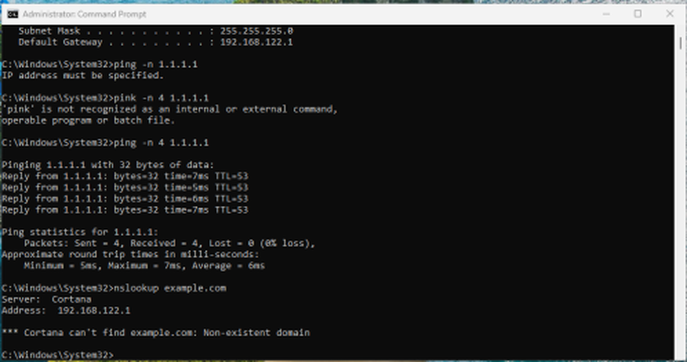
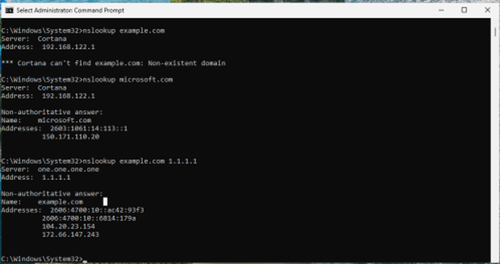
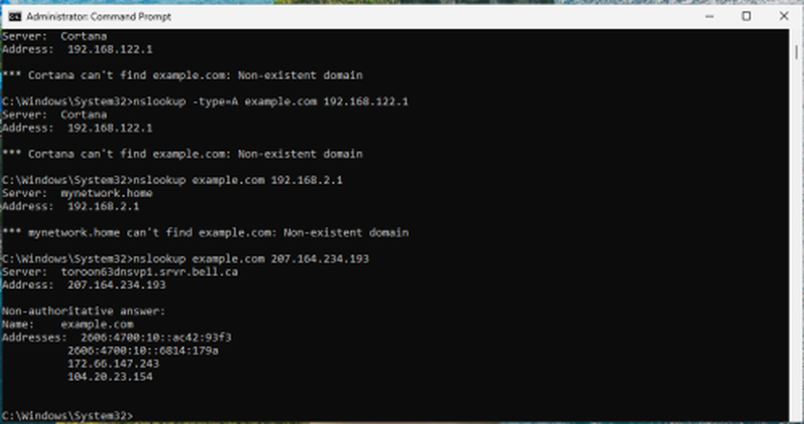
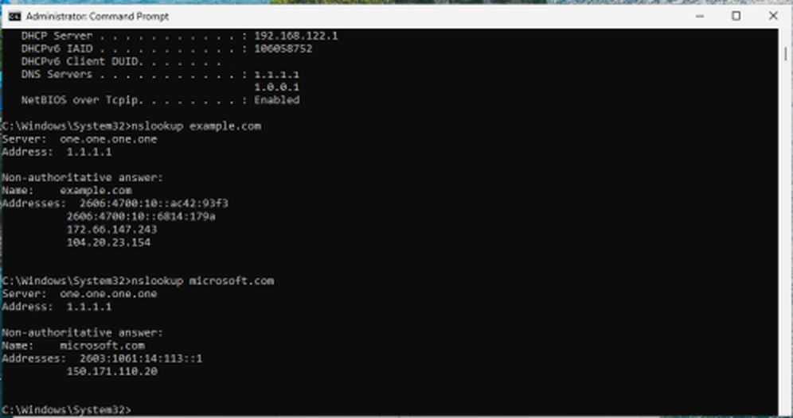

# HD-001 — Domain-specific DNS resolution failure

| Field | Detail |
| --- | --- |
| Date | 2026-11-15 |
| Environment | Windows 11 Enterprise Evaluation guest on Ubuntu QEMU/KVM |
| Ticket type | Self-directed home-lab exercise; the unexpected DNS failure was actually observed during baseline testing |
| Impact | `example.com` did not resolve through the VM's original DNS path. General internet access was not shown to be down. |
| Status | **Resolved with workaround**; underlying router/upstream cause unconfirmed |

## 1. Observed symptoms

Initial network baseline inside the Windows guest:

- A default gateway of `192.168.122.1` was present on libvirt's NAT network.
- `ping -n 4 1.1.1.1` succeeded with **4 replies and 0% packet loss**.
- `nslookup example.com` using the default DNS server (`192.168.122.1`) returned **Non-existent domain**.

**Initial assessment:** IP connectivity was available, while at least one domain lookup failed. This did **not** establish that all DNS queries were failing.

## 2. Diagnostic tests

| Test | Observation | Significance |
| --- | --- | --- |
| `nslookup microsoft.com` (default resolver) | Succeeded via `192.168.122.1` | DNS was not universally broken. |
| `nslookup example.com 1.1.1.1` | Succeeded | Public DNS could resolve the target domain. |
| `nslookup example.com 192.168.122.1` | Non-existent domain | Failure reproduced through VM default DNS. |
| `nslookup -type=A example.com 192.168.122.1` | Non-existent domain | Failure reproduced for an IPv4 address record. |
| `resolvectl query example.com` on Ubuntu host | Name not found | The Ubuntu host also exhibited a failure using its configured resolver path. |
| `resolvectl query --type=A microsoft.com` on Ubuntu | Succeeded | Ubuntu could resolve a different domain. |
| `nslookup example.com 192.168.2.1` | Non-existent domain | Home-router DNS path returned a negative response. |
| `nslookup example.com 207.164.234.193` | Succeeded | A separately configured secondary DNS server returned addresses. |

Ubuntu's `resolvectl status` showed Wi-Fi DNS servers `192.168.2.1` and `207.164.234.193`, with `192.168.2.1` current at the time. `virsh net-dumpxml default` showed libvirt's NAT bridge `virbr0` at `192.168.122.1` with a DHCP range in the `192.168.122.0/24` network.

## 3. Findings and diagnosis

The failure was **resolver-path-specific** rather than a total loss of IP or DNS connectivity. The VM's default resolver and the home router returned negative responses for `example.com`; Cloudflare and the separately queried secondary DNS server resolved it.

**Hypothesis, not confirmed root cause:** router DNS forwarding behavior, upstream policy/filtering, or a cached negative response. The tests did not prove which component produced the incorrect answer. No router logs, authoritative DNS traces, or packet captures were obtained.

## 4. Workaround applied

Only within the Windows 11 guest, the adapter's IPv4 DNS configuration was changed from its previous automatic resolver selection to:

- Preferred DNS: `1.1.1.1`
- Alternate DNS: `1.0.0.1`

The Ubuntu host, libvirt virtual network, physical home router, and Cortana project were not intentionally modified as part of this workaround. The guest remained on NAT networking.

## 5. Verification

The Windows Command Prompt screenshot after the change shows:

- The adapter listing `1.1.1.1` and `1.0.0.1` as DNS servers.
- `nslookup example.com` using `1.1.1.1`: **successful**.
- `nslookup microsoft.com` using `1.1.1.1`: **successful**.

**Result:** The reported domain-resolution symptom was corrected in the Windows VM at the time of retesting. This is a **workaround**, not a demonstrated repair of the upstream or home-router DNS service. Persistence after reboot was not tested in the captured evidence.

## 6. Lessons learned

1. Separate IP connectivity checks from name-resolution checks; `ping` to an IP does not validate DNS.
2. Avoid concluding that "DNS is down" from one failed domain query; compare known-good domains and resolvers.
3. Query specific DNS servers directly before changing settings.
4. Use a narrowly scoped workaround and retest the original failure condition.
5. Record limits of evidence and avoid claiming a root cause that was not established.

## 7. Evidence handling

These are crops of the actual Windows VM screenshots supplied during the lab session, not fabricated terminal outputs. A Windows DHCPv6 device identifier was masked from the final verification image before public packaging. Full-screen originals remain with the project owner and are **not included** in this public-ready repository package. See [evidence notes](../evidence/README.md).
